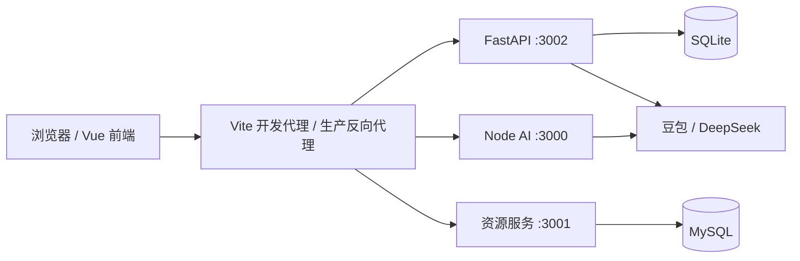

# 慧编云 · AI 辅助编程学习平台

我都行队参赛作品。面向编程学习场景，提供在线编程、课程学习、每日练习、班级测试、学习数据分析和教学管理。

## 团队

| 成员 | 分工 |
| --- | --- |
| 楚皓天 | 前端与后端开发 |
| 王欣 | 服务器部署、代码调试 |
| 申月帆 | 部分代码测试、功能演示、视频录制 |

GitHub 维护账号：Slime-Star。

## 核心功能

- 学生端：学习中心、课程播放、在线编程、每日打卡、错题本、班级测试、论坛、消息、积分与排行榜。
- 教师端：班级与题目管理、测试组织与批改、学生学习档案、知识点旭日图和 AI 学习分析。
- 管理员端：账号、教学内容、资源、积分、消息和操作日志管理，支持精确筛选、CSV 导出和关联删除预览。
- AI：豆包编程助手、DeepSeek 学习分析；提供超时处理、备用服务标识和本地分析回退。AI 调用需要自行配置服务账号和密钥。
- 交互：页面切换、卡片展开、登录衔接、课程轮播、动态主题装饰及侧边小游戏。

## 技术架构

| 部分 | 技术 | 默认端口 |
| --- | --- | --- |
| 前端 | Vue 3、Vite、Element Plus、ECharts、Ace | 5173 |
| 主后端 | Python、FastAPI、SQLite、WebSocket | 3002 |
| AI 与辅助服务 | Node.js、Express | 3000 |
| 资源服务 | Node.js、Express、MySQL | 3001 |
| 数据库 | MySQL（资源库）；SQLite（用户与学习记录） | 3306 / 本地文件 |



## 目录

```text
ai-code-learning/       Vue 前端、课程配置、图片和演示视频
code-runner-server/     FastAPI 主服务、AI 服务、管理员接口、Python 依赖
server/                MySQL 资源服务与初始化 SQL
docs/                  管理端使用说明
```

## 安装与本地运行

准备 Node.js 22 或更新版本、npm、Python 3.11、MySQL 8。若需要运行 Java、C、C++ 代码，还需安装对应 JDK、GCC/G++ 并加入 PATH。Node.js 的环境文件读取使用内置 `process.loadEnvFile`。

### 1. 获取源码

```bash
git clone https://github.com/Slime-Star/ai-code-learning.git
cd ai-code-learning
```

### 2. Python 主服务

```bash
cd code-runner-server
python -m venv .venv
```

Windows PowerShell 执行 `.\.venv\Scripts\Activate.ps1`；Linux/macOS 执行 `source .venv/bin/activate`。

```bash
python -m pip install -r requirements.txt
```

复制 `.env.example` 为同目录的 `.env`，按模板填写 AI 密钥、模型及接口地址。PowerShell 可执行 `Copy-Item .env.example .env`，Linux/macOS 使用 `cp .env.example .env`。配置说明见 [AI_CONFIGURATION.md](code-runner-server/AI_CONFIGURATION.md)。未配置 AI 时无法调用云端模型，学习分析可显示本地统计。

```bash
python backend_new.py
```

主服务首次运行会初始化自己的 SQLite 数据库，并从前端配置导入课程和练习目录。仓库不包含开发机上的用户数据库、登录会话或上传文件。

### 3. AI 与辅助服务（另开终端）

```bash
cd code-runner-server
npm ci
npm start
```

该进程与 Python 服务共同读取 `code-runner-server/.env`。

### 4. 资源服务（另开终端）

先在 MySQL 客户端中执行 `server/source.sql`，创建 `source` 数据库和资源表。该 SQL 包含资源初始化示例，不包含用户账号及学习记录。

```bash
cd server
npm ci
```

复制 `server/.env.example` 为 `server/.env`，填写自己的 MySQL 用户名和密码，再启动：

```bash
node index.js
```

### 5. 前端（另开终端）

```bash
cd ai-code-learning
npm ci
npm run dev
```

打开终端显示的本地地址，默认 `http://localhost:5173`；端口被占用时 Vite 会选择后续可用端口。首页为学习中心，导航中的“首页”进入编程器。注册和登录后体验对应角色功能。

### 管理员初始化

先启动一次 Python 服务完成建表，再在 `code-runner-server` 目录、已激活的 Python 环境中执行：

```bash
python manage_admin.py contest_admin
```

按终端提示在本机输入自己的密码。不要将管理员密码写入仓库。管理入口为 `/admin`，操作说明见 [管理端使用说明](docs/管理端使用说明.md)。

## 构建与部署

在前端目录运行 `npm run build`，产物位于 `ai-code-learning/dist/`。当前生产资源基路径为 `/ai-code-learning/`；如部署到域名根路径，需要相应调整 `vite.config.js` 的 `base` 和路由回退。

生产环境需部署三个后端进程并通过反向代理映射 `/api/ai/chat` 到 3000、`/api/resources` 到 3001、其余 `/api`（含 WebSocket）到 3002。单独发布前端静态文件不能提供登录、数据管理及 AI 功能。判题入口 `/api/judge` 由本仓库的 FastAPI 主服务提供，开发代理同样指向 3002。

编程执行会调用服务器上的语言运行时；部署到可访问的网络环境前，应对执行服务配置隔离、资源限额与访问控制，并使用 HTTPS。数据库、密钥文件和上传目录应单独备份与管理。

## 版本记录与提交材料

保留原远程仓库已有 Git 提交历史；当前版本通过新的正常提交补充完整工程，不重写时间、不补造开发记录。后端在本次整理前没有独立 Git 历史，本次提交保存其当前源码。

本仓库用于提交源码与环境说明。参赛演示视频需要团队另行录制并提交；仓库中的课程演示片段不等同于作品演示视频。团队应按赛事要求准备 5–8 分钟、1080p 或以上的 MP4，并以普通话说明项目、核心功能和 AI 技术亮点。

## 素材与配置

课程轮播图片的来源说明见 [素材说明](ai-code-learning/src/assets/learning-hero/README.md)。第三方图片、依赖与课程素材各遵循其原有授权，不因本项目公开而变更授权。

所有 `.env`、真实用户数据、运行日志、依赖目录、打包产物和压缩备份均不纳入本次源码提交。环境变量模板与锁定的依赖清单保留在对应服务目录。
